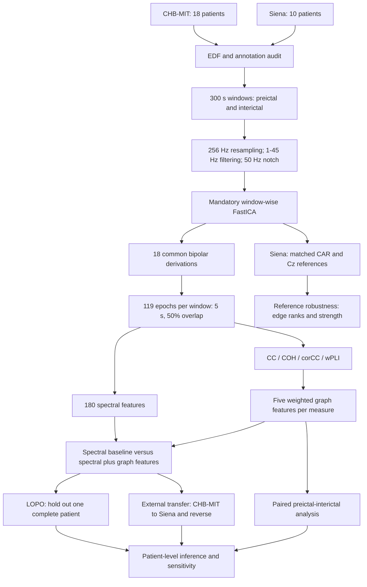

# EEG Reference Robustness

**Reference Robustness and Cross-Patient Generalization of Preictal Scalp-EEG Connectivity**
Hassen Ouni and Lotfi Saidi

A modular Python implementation of the manuscript's EEG processing and analysis workflow. The repository covers patient selection, annotated window construction, window-wise ICA, spectral and connectivity estimation, weighted graph features, reference robustness, patient-independent validation, bidirectional external transfer, and patient-level inference.

## Scientific objective

The study asks whether scalp-EEG connectivity measures that remain stable after a reference change also preserve preictal information across patients and independent datasets. Four measures are implemented on the same cleaned signals: cross-correlation (CC), coherence (COH), corrected cross-correlation (corCC), and weighted phase-lag index (wPLI).

The workflow connects four complementary analyses: controlled reference robustness in Siena, paired preictal-interictal differences in both cohorts, leave-one-patient-out validation, and bidirectional transfer between CHB-MIT and Siena. The implementation concerns retrospective classification of annotated five-minute windows.

## Paper workflow



### Four analysis components

| Analysis | Scientific comparison | Statistical unit |
|---|---|---|
| Reference robustness | Matched CAR and Cz networks in the same cleaned Siena windows; topology similarity and relative strength change | Patient means over eight windows |
| Preictal-interictal differences | Mean network strength before seizures versus seizure-distant controls | Paired difference per patient |
| Patient-independent validation | Spectral features versus the same features plus five graph features; linear SVM with LOPO | Held-out patient AUROC |
| External generalization | Train once on one dataset, apply unchanged to the other; evaluate both directions | Target patient average precision |

Scaling and classifier fitting use training data exclusively. Epochs are averaged within their parent window and are never counted as independent patients. [Read the complete EEG pipeline](docs/PIPELINE.md) for the transformations, feature definitions, and interfaces between stages.

## Start here

- [Reviewer guide](docs/REVIEWER_GUIDE.md): a short route through the implementation.
- [Paper-to-code map](docs/PAPER_TO_CODE.md): manuscript sections and corresponding functions.
- [Signal-processing protocol](docs/METHODS.md): equations, parameters, aggregation, and graph conventions.
- [Data and annotations](docs/DATA.md): expected input layout and selection rules.
- [EEG pipeline](docs/PIPELINE.md): signal transformations and the four analysis branches.
- [Workflow and outputs](docs/WORKFLOW.md): commands and generated artifacts.
- [Technical validation](docs/VALIDATION.md): scope of the synthetic tests.

## Installation

Python 3.10 or 3.11 is recommended for the supplied reference environment. From the repository root:

```bash
python -m venv .venv
# Windows: .venv\Scripts\activate
# Linux/macOS: source .venv/bin/activate
python -m pip install -r requirements.txt
python -m pip install -e ".[dev]"
python -m pytest -q
python -m eegref --help
```

`requirements.txt` pins the numerical environment. `pyproject.toml` specifies compatible dependency ranges for installation as a package. No EDF recordings, trained models, or study performance tables are distributed.

## Run individual stages

Place the original PhysioNet EDF files and their annotation files in the layout described in [DATA.md](docs/DATA.md). No command downloads data automatically.

```bash
# Select patients and windows; inspect EDF headers and seizure annotations only.
python -m eegref audit --data-root /path/to/data --output outputs/study

# Process EEG and extract features; this command does not fit a classifier.
python -m eegref extract --data-root /path/to/data --output outputs/study --workers 2

# Optional: fit linear SVMs and perform patient-level evaluation.
python -m eegref evaluate --output outputs/study

# Optional: recompute patient-omission sensitivity from saved scores.
python -m eegref sensitivity --output outputs/study

# Optional: generate the analysis tables and figures from computed artifacts.
python -m eegref report --output outputs/study
```

`python -m eegref run --data-root /path/to/data --output outputs/study` executes extraction followed by evaluation. The configuration defaults to `config/study.json`; `--data-root` overrides only the data location. Use quoted paths when they contain spaces. Do not run concurrent commands against the same output folder.

## Protocol at a glance

| Component | Implementation |
|---|---|
| Independent unit | Patient; chb01/chb21 grouped together |
| Cohort | 18 CHB-MIT and 10 Siena patients, selected using technical availability |
| Windows | 300 s preictal; nonoverlapping interictal candidates with a 1 h seizure guard |
| Preprocessing | 256 Hz, 1-45 Hz Butterworth, 50 Hz notch, mandatory window-wise FastICA |
| Prediction montage | The same 18 bipolar derivations in both datasets |
| Epochs | 119 epochs of 5 s, step 2.5 s |
| Spectral baseline | 18 derivations x 5 bands x 2 powers = 180 features |
| Connectivity | CC, COH, corCC, classical unsquared wPLI |
| Graphs | Five weighted graph features per connectivity measure |
| Reference experiment | Same cleaned Siena windows, CAR over 19 electrodes versus Cz; exclude Cz |
| Models | StandardScaler + linear SVC, C=1; scaling fitted on training data only |
| Validation | LOPO AUROC and source-only bidirectional transfer AP |
| Inference | Paired patient differences, nominal Student t intervals, t/Wilcoxon tests, BH-FDR |

## Repository layout

```text
config/study.json          Fixed analysis protocol and configurable data location
src/eegref/                Importable implementation and command-line stages
tests/                     Synthetic numerical and workflow tests
manifests/                 Manifest guidance; real patient/window records are generated locally
docs/                      Methods, traceability, data, and reviewer documentation
scripts/                   Synthetic demonstration and release packaging
.github/workflows/         Automated test workflow
```

The manuscript defines the scientific protocol. Explicit implementation conventions for details such as disconnected graph paths, feature ordering, and annotation handling are recorded in [METHODS.md](docs/METHODS.md). Technical tests check software behavior; they do not constitute a full EDF study execution.

## Citation and reuse

See [CITATION.cff](CITATION.cff) and cite the accompanying manuscript when available. No DOI or publication status is assumed. Licensing is described in [LICENSE](LICENSE). Dataset rights remain with the dataset providers.
