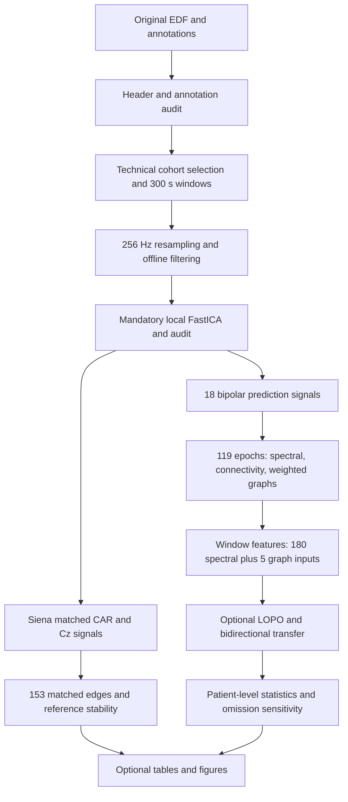

# Workflow and artifact contract



Run all commands from the repository root after installation. `--output` defines one analysis directory; stages reuse it. Relative `data_root` values are resolved from the invocation directory. `--workers` controls independent extraction processes; one worker is the default to limit memory usage. The ICA fit limits numerical thread pools internally.

## Commands

| Command | Reads | Writes | Classifier training |
|---|---|---|---|
| `audit` | EDF headers and original annotation text | Inventory, selection, windows, audit issues | None |
| `extract` | Original EEG samples, config | Audit artifacts, feature table, ICA audit/cache, robustness summaries, run metadata | None |
| `evaluate` | `features.csv` | Patient scores, window decisions, paired contrasts, preictal effects | Linear SVM only |
| `sensitivity` | Saved patient differences | Omission-level and summary CSVs | None |
| `report` | Inventory, windows, cache, robustness, evaluation | Tables and 300 dpi PNG/SVG figures | None |
| `run` | Source data | Extraction followed by evaluation and sensitivity | Linear SVM only |

`evaluate` also calls sensitivity. It does not read EDFs. `report` is explicit and never runs training. To include ages and sex in Table 1, provide an independently prepared CSV with `dataset,patient,age_years,sex` (M/F); chb01/chb21 must use one chb01 record with the first-session age.

```bash
python -m eegref report --output outputs/study --demographics /path/to/demographics.csv
```

Without that optional file, Table 1 contains computable source/cohort counts and omits demographic values rather than inventing them. Table 1 source durations count complete selected source EDFs, not epoch durations. Cohort and source-file scope is the pre-extraction window selection; preprocessing exclusions are reported separately.

## Output schema

- `inventory.json`: relative source path, dataset, case, patient, duration, channels, acquisition clock, seizure intervals, exclusions, header fingerprint.
- `cohort_ranking.csv`: availability criteria, eligibility, technical rank, selected flag.
- `cohort.csv`: pre-extraction counts and selection status per independent patient.
- `windows.csv`: unique ID, source path, dataset, case, patient, start/stop/context seconds, binary label (1 preictal, 0 interictal), robustness flag.
- `features.csv`: one row per successful window; 180 spectral columns, four sets of five graph columns, source sample digest, epoch count, and ICA summary.
- `extraction_errors.csv`: excluded window ID, path, and processing traceback.
- `ica_audit/<window_id>.json`: ICA rank, components, numerical artifact scores, reasons, iterations, and energy fraction.
- `cache/<key>.npz`: numerical features, mean edges, ICA matrices/mean, source digest, and matched reference edges when requested.
- `robustness_windows.csv`, `robustness_patients.csv`, `robustness_summary.csv`: paired reference metrics, patient aggregation, cohort mean/sample SD.
- `run.json`: normalized config, code/config/environment signature, manifest hash, package versions, UTC timestamps, stage status, extraction counts. `classifier_fitted` refers to the extraction stage only.
- `evaluation/patient_scores.csv`: experiment, direction, patient, model, AUROC, AP, class prevalence, test windows, training windows.
- `evaluation/predictions.csv`: window-level label and continuous held-out decision score.
- `evaluation/comparisons.csv`, `patient_deltas.csv`: method-level inference and paired patient gains.
- `evaluation/family_contrasts.csv`, `family_patient_deltas.csv`: robust-minus-conventional family inference and patient differences.
- `evaluation/preictal_effects.csv`, `preictal_patient_effects.csv`: unstandardized paired strength differences.
- `evaluation/sensitivity_exclusions.csv`, `sensitivity_summary.csv`: omission results without retraining.
- `report/`: Tables 1-6 and Figures 2-5 generated from computed artifacts. Figure 1 is the conceptual workflow above. Figure layouts implement the analyses rather than duplicating manuscript artwork pixel for pixel.

## Cache and failures

Cache identity includes configuration, implementation hash, numerical dependency versions, window row, source file size/mtime, and header hash. Each cache also stores a digest of samples actually read. Source files must be immutable during analysis. Metadata fingerprints are not a full-file cryptographic proof for large EDFs.

A changed code/config/environment requires a new output directory. Cache writes use a temporary file and replacement. Non-convergent ICA never falls back to uncleaned data. Extraction records failures, saves successful windows, and fails if either dataset lacks the requested number of patients with both states. Reference summaries require all eight successful paired windows for each patient/method. Review window exclusions and robustness patient counts before interpretation.
